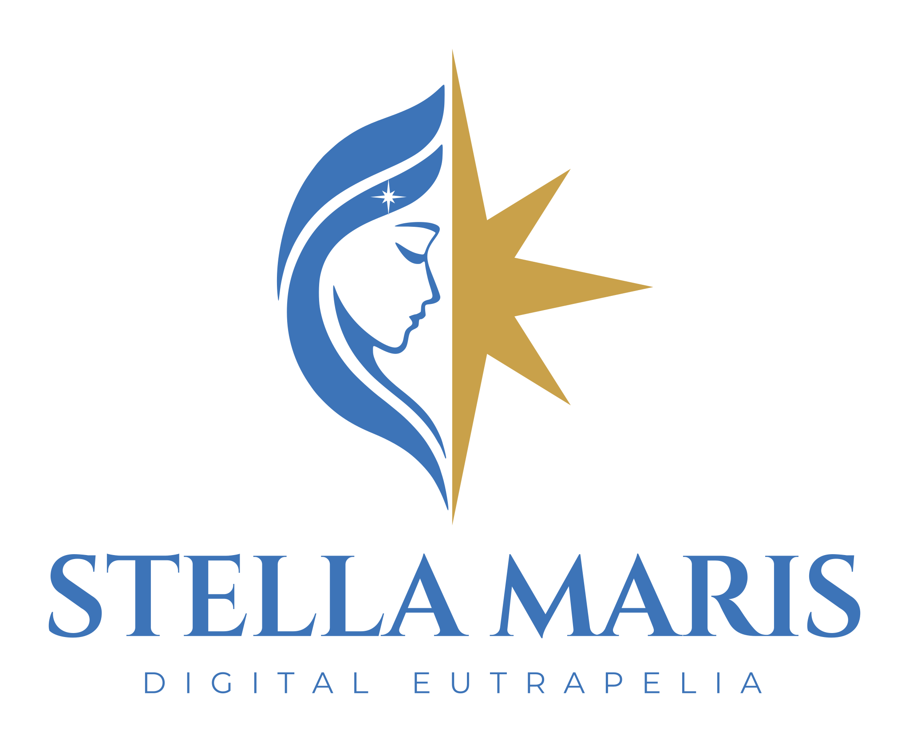

  

  <em><strong>Stella Maris - Digital Eutrapelia</strong> is a budding video game studio dedicated to inspiring players through compelling storytelling, immersive worlds, and memorable portrayals of traditional archetypes.</em>

## Philosophy

We love games. We've grown up with them. Yet the gaming space has felt, for
some time now, like somewhere traditional values, inspiring characters, and
genuine portrayals of the struggle between good and evil have a hard time
taking the stage.

Conversely, it seems that those who still struggle for these values have
developed a disinterest in video games as a medium, if not even a disdain for
them. Gaming is considered by many a juvenile and immature activity, unfit to
elevate the mind or nourish the spirit beyond mindless entertainment.

Yet video games remain the language of a generation. Giving up on them means
giving up on one of the most influential forms of communication of our time.

We're out to fight both of these tendencies. We do so by creating content that
everyone can enjoy—not kitschly devotional, but content that does not renounce
carrying a message; or rather, **the Message**.

## Currently working on...

We're currently developing a **fantasy real-time role-playing / strategy game**
with open-ended modding, distinctive mechanics, and a rich narrative campaign
featuring a memorable cast of characters.

**Stay tuned!**